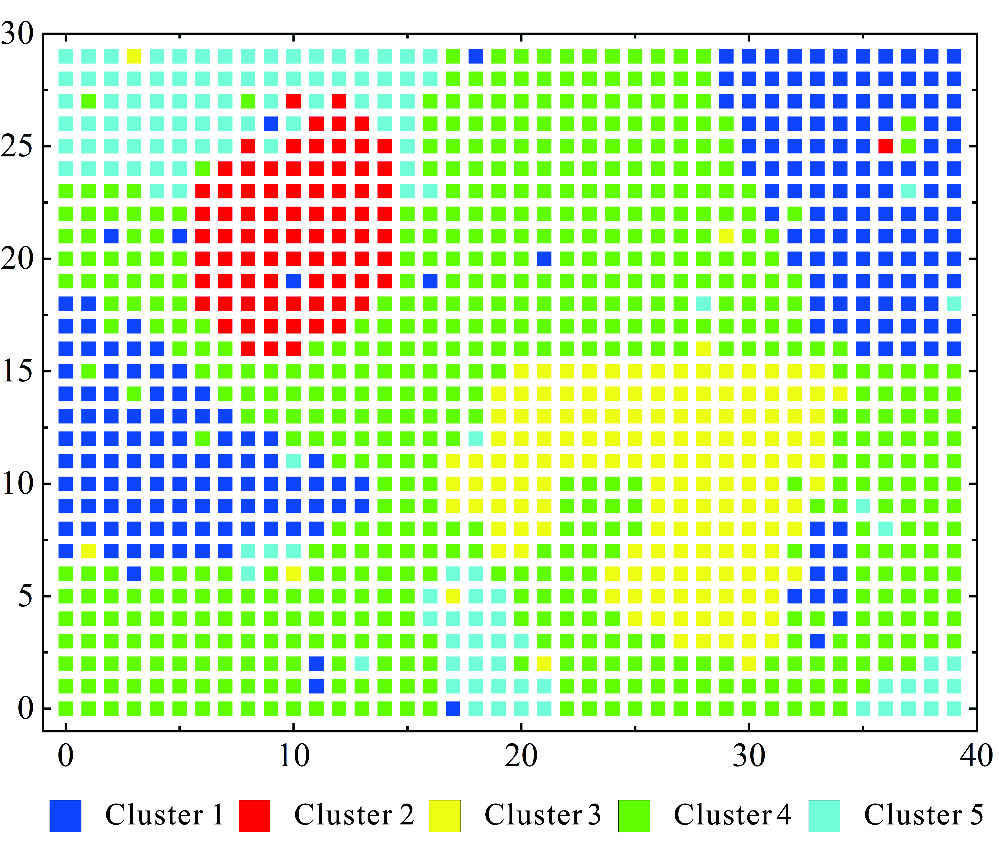
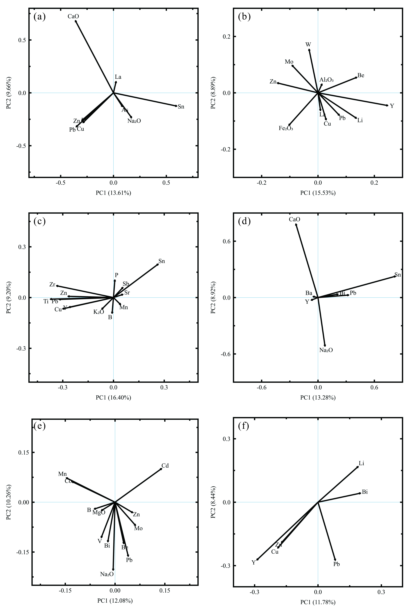

# EM–FMCD geochemical anomaly analysis

Code accompanying the manuscript *Detection of multivariate geochemical anomalies using the EM–FMCD method: a case study in southwestern Hunan, China*. The workflow combines Gaussian mixture clustering, robust principal component analysis (RPCA), and fast minimum covariance determinant (FMCD) to investigate multivariate geochemical anomalies.

## Contents

- [Source code](src/) contains the interactive programs and supporting preprocessing tools.
- [Synthetic example](examples/synthetic_case/) provides a 1,200-sample dataset, step-by-step instructions, intermediate data, results, and figures.
- [Tests](tests/) contains syntax and numerical checks.
- [Requirements](requirements.txt) lists the Python dependencies.

## Installation

Install Python with Tkinter and a graphical desktop. Clone the repository and install its dependencies:

```bash
git clone https://github.com/xingfu100/Detection-of-multivariate-geochemical-anomalies-using-the-EM-FMCD-method.git
cd Detection-of-multivariate-geochemical-anomalies-using-the-EM-FMCD-method
python -m venv .venv
```

Activate the environment with `.venv\Scripts\activate` on Windows or `source .venv/bin/activate` on macOS/Linux, then run:

```bash
python -m pip install -r requirements.txt
```

## Workflow

1. Prepare positive, unit-consistent concentration data and compute the centered log-ratio (CLR) transformation. [01_preprocessing.py](src/01_preprocessing.py) provides cleaning and transformations; its detection limits are specific to the original study and must be checked for other datasets.
2. Use [1_EM&AIC.py](src/1_EM%26AIC.py) to fit Gaussian mixtures and assign samples to groups. The example uses five components and random seed 42.
3. Use [2_RPCA.py](src/2_RPCA.py) on positive raw concentrations for each group and for the whole region. The program applies ILR and robust PCA and maps the loadings into CLR space.
4. Use [3_FMCD.py](src/3_FMCD.py) with the selected columns from the full CLR table to calculate robust Mahalanobis distances. Run each group and the whole region separately.

These programs have interactive Chinese-language dialogs. The first two columns of the input tables are coordinates; retain sample order when joining cluster assignments to concentrations and CLR data. Further details, inputs, parameters and outputs are described in the [synthetic example guide](examples/synthetic_case/README.md). The additional numbered scripts in `src` provide preprocessing and related analysis utilities.

## Synthetic example

The example contains 1,200 artificial samples with 39 elements and grid coordinates. It includes saved EM groups, RPCA inputs and loadings, FMCD inputs and outputs, and the figures below. The images were prepared by the authors for the synthetic case; they are not maps of the study area.






For the RPCA and FMCD figures, panels (a)–(e) show clusters 1–5 and panel (f) shows the whole region. The displayed loading vectors are a subset chosen for illustration; they do not necessarily match the FMCD input variables. For example, Sn is included in the regional FMCD input but is not shown in panel (f). See the [example guide](examples/synthetic_case/README.md) to run the calculations and inspect the individual tables.

## Tests

From the repository root, run:

```bash
python tests/quick_test.py
python tests/numerical_test.py
```

The first command checks syntax; the second checks numerical operations using synthetic data. Both print `PASS` when successful. They do not reproduce the manuscript's results or test every graphical interface operation.

## Data availability

The regional stream sediment geochemical data used in this study are not publicly available because the authors do not have permission to redistribute the original dataset.

The synthetic dataset is included to demonstrate the workflow; it does not reproduce the original study data or results.

## License

The code is distributed under the [MIT License](LICENSE).
